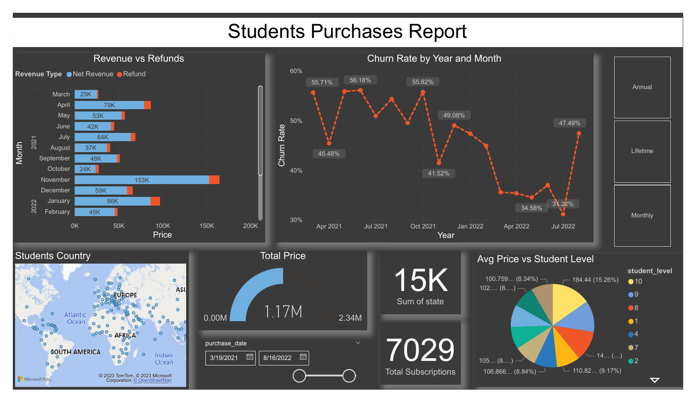

# Student Purchases Analysis

A Power BI report analysing student subscriptions (lifetime, annual and monthly), revenue, refunds and churn. Built while following the *Data Analysis in Power BI with ChatGPT* course by 365 Data Science.

## What's in the dashboard
- **Revenue vs. refunds** by month (March 2021 – February 2022)
- **Churn rate** by year and month
- **Students by country** on a world map
- **Average price vs. student level**
- **KPI cards:** total price (1.17M) and total subscriptions (7,029)
- **Filters:** subscription type (annual / lifetime / monthly) and purchase-date range (Mar 2021 – Aug 2022)

## Repository contents
| File | Description |
|---|---|
| `Students Purchases Report.pbix` | Power BI report. Open it with Power BI Desktop to explore and filter |
| `Students Purchases Report.pdf` | Static export of the report |
| `images/dashboard-preview.png` | Preview image used in this README |

## How to use
1. Download `Students Purchases Report.pbix` and open it in [Power BI Desktop](https://powerbi.microsoft.com/desktop/) (free, Windows).
2. Click Annual, Lifetime or Monthly, or change the date range, to filter the report.

## Tools
Power BI Desktop

## Credits
Course: *Data Analysis in Power BI with ChatGPT*, 365 Data Science.

## License
See [LICENSE](LICENSE).
